<p align="center">
  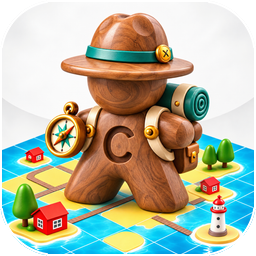
</p>

<h1 align="center">CarcaGem</h1>

<p align="center"><strong>Build an island. Master your strategy.</strong><br>
Place landscape tiles, connect features, and send ocean-animal explorers to claim them. Every tile can change the island—and your plan.</p>

<p align="center"><a href="https://carcagem.online/"><strong>Play the latest online version →</strong></a> · <a href="https://carcagem.online/player-guide.html">Open the interactive Player Guide</a></p>

<p align="center">
  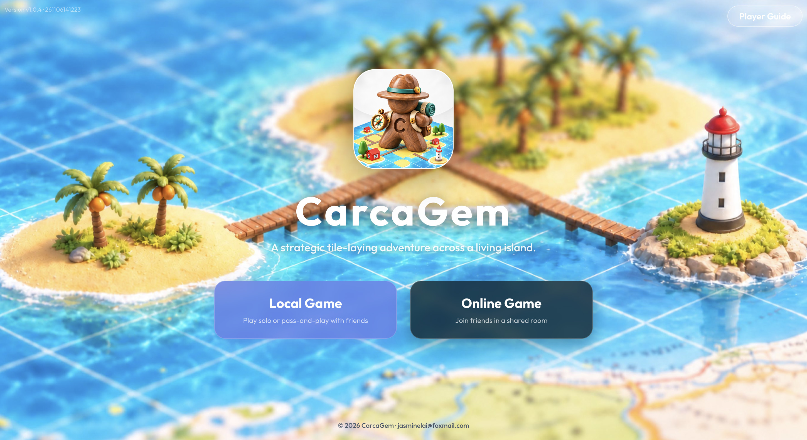
</p>

## Watch AI players in action

Watch AI players build the island, place explorers, and score features in this **2-minute, 12-second** gameplay video.

https://github.com/user-attachments/assets/0bf076af-8bc7-4395-8277-dcf74e529e89

[Watch or download the original 1080p gameplay video (MP4)](https://media.githubusercontent.com/media/laizhiyin/carcagem/main/public/backgrounds/carcagem1080p.mp4).

## The game at a glance

| 25 tile types | 80 tiles in a game | 2–3 players | 8 explorers per player |
| --- | --- | --- | --- |

The 80-tile set includes the starting tile. Play against AI, take turns with friends on one device, or meet in an online room from separate devices. Players choose a nickname and color; each player is also given a distinct ocean-animal avatar.

| Nemo | Shelly | Ray | Sunny |
| --- | --- | --- | --- |
| 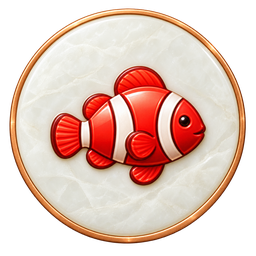 | 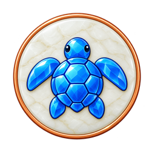 | 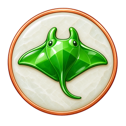 | 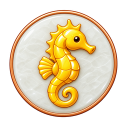 |

### Choose how to play

| Local Game | Online Game |
| --- | --- |
| Play against AI or pass the same device between 2 or 3 players. Choose a human or AI seat, then take turns in order. | Create a room, share its invite code, and play with friends on their own devices. The host starts the game. |

## Read the board

The next tile appears at the top left, player cards sit on the right, and the island grows in the center. Translucent spaces show legal placements. Drag to pan, choose a space, then rotate the tile or select a different position.

<p>
  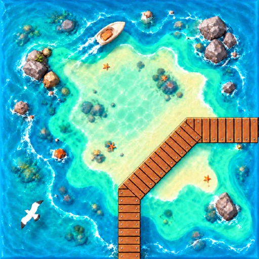
  
  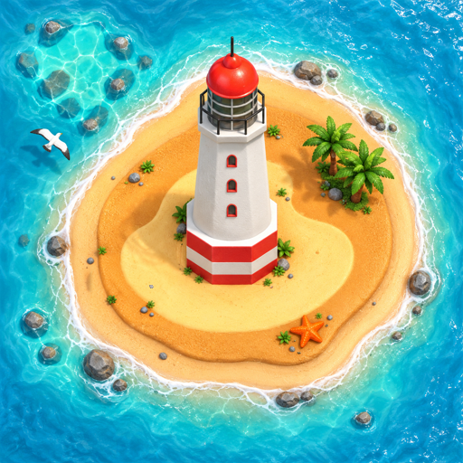
</p>

| Next tile | Player cards | Claimable positions |
| --- | --- | --- |
| The counter shows tiles left in the deck out of 80. The current tile has already been drawn. | Cards show each player's avatar, nickname, score, and available explorers. The active player is highlighted. | Colored dots mark places where an explorer can claim a feature: blue sea, brown road, yellow beach, or red lighthouse. |

## A turn in three moves

<p>
  
  
  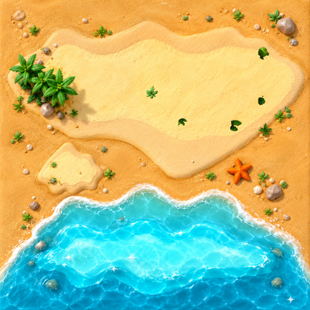
</p>

| 1. Place a tile | 2. Claim or skip | 3. Score and continue |
| --- | --- | --- |
| Place the drawn tile in a legal space. Every touching edge must match: sea to sea, beach to beach, and road to road. Press **R** to rotate it. | Optionally place one available explorer on an unclaimed feature marked on the new tile. Press **Space** or choose Skip to keep the explorer in reserve. | A completed road, beach, or lighthouse scores automatically, and its explorers return. Explorers claimed at sea stay there until the game ends. |

You cannot claim a connected feature that already has an explorer, even if it belongs to you. You can still place tiles after using all your explorers; you just cannot claim another feature until one returns.

## Four features, four scoring rules

<p>
  
  
</p>

| Road / boardwalk | Beach |
| --- | --- |
| A road is complete when every open end connects to another road. Score **1 point per distinct tile**, when completed or unfinished at game end. | A beach is complete when all outward edges connect with no gaps. Score **2 points per tile when complete** and **1 point per tile if unfinished** at game end. |

<p>
  
  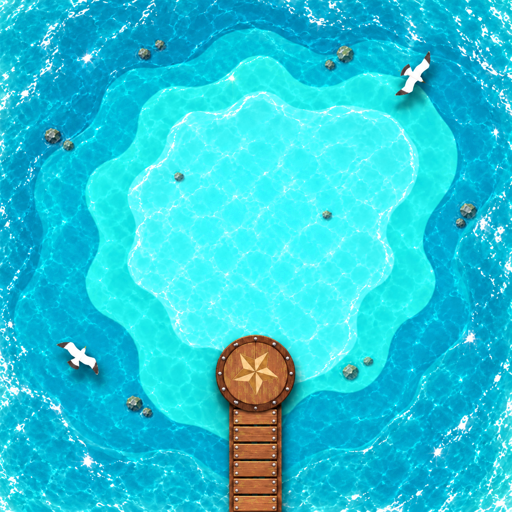
</p>

| Lighthouse | Sea |
| --- | --- |
| A lighthouse is complete when all **8 surrounding spaces**, including diagonals, contain a tile. It scores **9 points**; if unfinished at game end, score surrounding tiles **+1**. | Sea scores only at game end: **3 points for each different completed beach** connected to that sea. Count each beach once. Open beaches and lighthouses do not count. |

For a scored feature, the player with the most explorers earns its full value. Every player tied for the most also earns the full value; points are not split. Sea explorers remain committed until the end and do not return during play.

## Treasure tiles earn bonus turns

Red gems mark treasure tiles. When a **road or beach** containing a treasure tile is completed and has at least one explorer, the player or players with the most explorers in that feature earn an extra turn. Drawing or placing a gem tile alone does not trigger the bonus.

<p>
  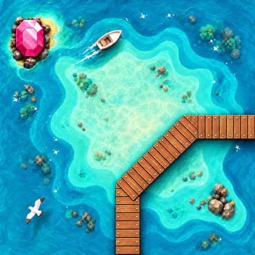
  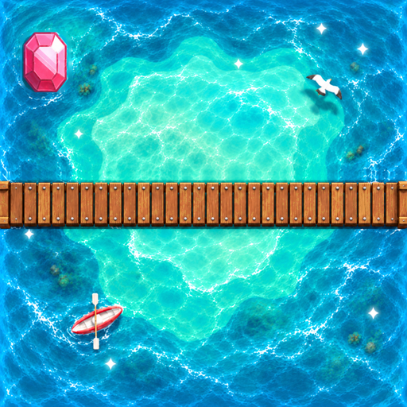
  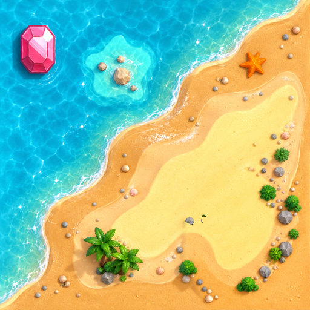
  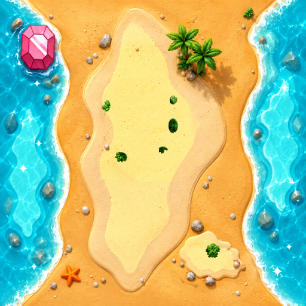
</p>

*Treasure tiles 22, 23, 24, and 25 (in order).*

## The finish and a few smart moves

The game ends when the last tile has been placed and scored, or when no remaining tile can be placed legally. Unfinished roads, beaches, and lighthouses score, along with claimed seas. Previously scored features are not scored again; add endgame points to the running totals. The highest total wins.

- Keep **1–2 explorers in reserve** when you can. Short roads and easy beaches can score sooner and return explorers for another claim.
- Check **Remaining Tiles** before investing more explorers in a difficult feature.
- Think twice before claiming a sea: sea explorers stay there until the end, so estimate how many completed beaches it may touch.
- Count explorers before connecting separate features. A connection can change who has the majority—and may complete a treasure feature.

## Remaining tiles and controls

<p>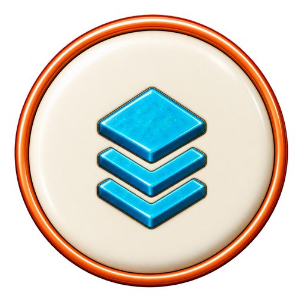 Select the layered-tile button to view all 25 tile types in a 5 × 5 grid. Counts show tiles still in the deck—not the tile in hand or tiles already on the board—and add up to the deck counter. The starting tile is part of the 80, so a new game begins with 78 tiles left after the first tile is drawn.</p>

| Control | What it does |
| --- | --- |
| **R** | Rotate the current tile. |
| **Space** | Skip explorer placement and confirm the tile. |
| **Esc** | Close Remaining Tiles, or cancel a selected position. |
| **Ctrl / ⌘ + Z** | Undo a turn in local games. Online games do not support undo. |

On desktop, drag or scroll to pan; hold **Ctrl** while scrolling to zoom. On mobile, drag with one finger to pan, pinch with two fingers to zoom, and move two fingers together to pan. Tap tiles, positions, and markers to play. Fullscreen is available on supported desktop browsers.

### Quick answers

- **No legal space for the current tile?** The game checks another tile. It ends if no remaining tile can be placed legally.
- **No explorers left?** Keep placing tiles and skip explorer placement until one returns.
- **Can I undo online?** No. Undo is available in local games only.
- **What happens if players tie for majority?** Each tied player receives the feature's full score and any applicable treasure turn.

## Play CarcaGem

<p align="center"><a href="https://carcagem.online/"><strong>Play the latest online version at carcagem.online →</strong></a></p>

For the full interactive guide—with the board walkthrough, tile rotation demo, live scoring examples, treasure gallery, and expanded FAQ—visit the [Player Guide](https://carcagem.online/player-guide.html).

## Run locally

Requirements: Node.js 20.19+ or 22.12+, and npm.

The original gameplay video is stored with Git LFS. Install [Git LFS](https://git-lfs.com/) before cloning, or run `git lfs install` and `git lfs pull` in an existing checkout to download the full video.

```sh
npm install
npm run server
```

In a second terminal, start the browser client:

```sh
npm run dev
```

Open the Vite URL shown in the terminal. The local client uses `http://localhost:3001` for multiplayer and analytics APIs. To build the browser app and server, run `npm run build`; then run `npm start` to start the production server.

| Command | Purpose |
| --- | --- |
| `npm run dev` | Start the Vite development client. |
| `npm run server` | Build and run the local multiplayer/API server. |
| `npm run build` | Build the browser app and server. |
| `npm run lint` | Run ESLint. |
| `npm test` | Run the Vitest suite. |
| `npm run check:assets` | Check that referenced game assets exist. |

See [Game Rules](docs/rules.md), [Architecture](docs/architecture.md), and [Server Deployment](docs/DEPLOYMENT.md) for project details.

## Contact

For project questions, email [jasminelai@foxmail.com](mailto:jasminelai@foxmail.com).
