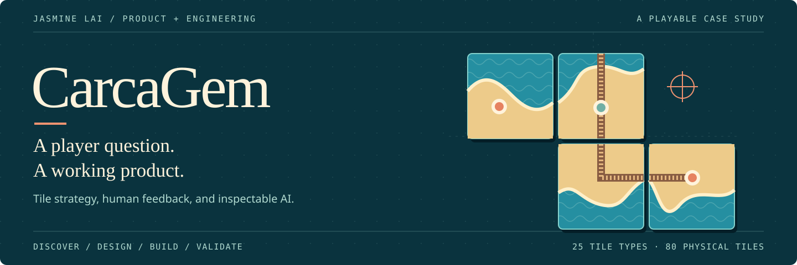
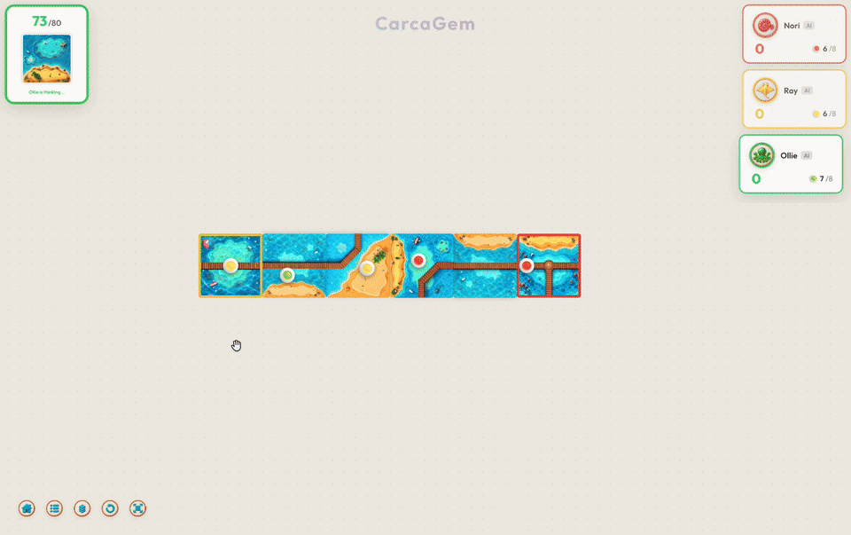
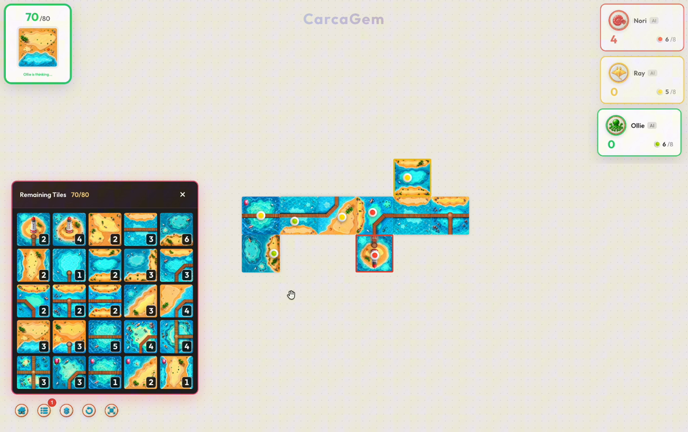

<h1 align="left"></h1>

<p align="center"><strong>Language / 语言</strong>　<strong><a href="README.md">🇺🇸 English</a></strong>　·　<a href="README.zh-CN.md">🇨🇳 简体中文</a></p>

<p align="center">
  <picture>
    <source media="(max-width: 600px)" srcset="docs/media/cover-mobile.svg">
    
  </picture>
</p>

**A browser strategy game built from player feedback, with an inspectable AI opponent.**

For casual strategy players on phones and computers, CarcaGem makes tile placement, claiming and scoring visible in one board. Play against AI, share a device, or invite friends into an online room.

Created and led by **Jasmine Lai**, a chemistry student using **Codex as an AI coding tool**. I owned product direction, UI, implementation decisions, deployment and validation. [Contribution boundaries](docs/CONTRIBUTIONS.md)

<p align="center">
  <a href="https://carcagem.online/"><strong>PLAY CARCAGEM ↗</strong></a> &nbsp; · &nbsp;
  <a href="#01--try-one-decision"><strong>TRY THE EXAMPLE</strong></a> &nbsp; · &nbsp;
  <a href="#02--inspect-three-code-paths"><strong>INSPECT THE CODE</strong></a> &nbsp; · &nbsp;
  <a href="docs/PLAYER_GUIDE.md">Player guide</a>
</p>

<table>
  <tr>
    <td width="50%" align="center"><strong>20+</strong><br>External playtesters</td>
    <td width="50%" align="center"><strong>100+</strong><br>Games with external players</td>
  </tr>
  <tr>
    <td align="center"><strong>10+</strong><br>Product iterations</td>
    <td align="center"><strong>65 passing</strong><br>Automated tests</td>
  </tr>
</table>

Playtesting and iteration counts are owner-reported. The automated results are reproducible below.

<p align="center">
  
</p>

*Actual gameplay: inspect a tile, follow an AI turn, and see the board and scores change. Full desktop and mobile recordings are below.*

**A 3–5 minute tour:** play a turn → inspect three code paths → follow a player request → reproduce the checks.

## 01 / Try one decision

In the [browser demo](https://carcagem.online/), choose **Local Game**, keep the default human/AI seats, and start. Select a highlighted placement, rotate with **R**, then claim a feature or skip. The AI takes the next turn.

For a repeatable input → decision → output, use Node.js 24 and the committed lockfile:

```sh
npm ci && npm run demo
```

| Step | What you can inspect |
| --- | --- |
| **Input** · [fixture](examples/ai-turn.fixture.json) | 5 board tiles; tile type 20 drawn; 74 tiles left; Nemo has 6 explorers available. |
| **Decision** · [executable example](examples/ai-turn.ts) | Evaluate 48 legal candidates from the public snapshot; choose `(0, 2)`, rotation `0`, `road-0`. |
| **Output** · asserted | Rules accept the move; Nemo gains **2 points**; the explorer returns; 73 tiles remain; Ray is next. |

This curated example uses a fixed candidate cap. Production also performs time-bounded sampled search; the example is not a strength benchmark.

## 02 / Inspect three code paths

| Entry | What to inspect | Tests or sample |
| --- | --- | --- |
| [Game state and scoring](src/engine/game.ts) | Turn transitions, feature completion, explorer return and idempotent final scoring. | [Rules and conservation](test_ai_upgrade.ts) |
| [AI policy](src/engine/ai/strategy.ts) | Legal candidates, inventory constraints, calibrated estimates and bounded opponent-aware search. Hidden deck order is excluded. | [Public-information/fallback tests](test_ai_upgrade.ts), [decision example](examples/ai-turn.ts) |
| [Multiplayer server](src/server.ts) | Server-validated actions, turn ownership, stale-result rejection and worker scheduling. | [Room start](test_network_start.ts), [synchronization](test_online_bonus_sync.ts), [worker failure](test_ai_pool.ts) |

The opponent combines symbolic rules, search and empirically calibrated estimates. It runs in browser/server workers without an external inference API. [Architecture](docs/architecture.md)

## 03 / Follow a player request

Players asked to see how many tiles remained. I treated this as a planning need: the answer had to be available **during a turn**, without hiding exhausted tile types or counting the tile already in hand.

I added a 25-type inventory panel in local and online play. Counts update after a move or local undo; Escape closes it and restores focus. [Implementation](src/components/RemainingTilesPanel.tsx) · [Four regression tests](test_remaining_tiles.ts)

<details>
<summary>See the delivered inventory panel</summary>



</details>

Players also requested a stronger AI. I improved its decision process and kept one production policy across local and online play. Human-strength observations remain qualitative; no controlled human win-rate study is claimed.

## 04 / What building CarcaGem taught me

> I began by sending Codex screenshots of things that looked wrong. Repeated fixes did not make me confident, because I could not yet explain the failure myself. The turning point was learning to name the regions and edges, write down the expected score, and make those states visible. I learned to use AI more effectively by becoming more precise about what the software had to prove.

*Adapted from my development notes.* [Five engineering lessons](docs/DEVELOPMENT_NOTES.md) connect these experiences to the current data model, graph traversal, tests and player-facing feedback.

## 05 / Check the evidence

| Claim | Evidence and boundary |
| --- | --- |
| Behavior is checked. | **65 tests in 11 files** pass locally; the fixed example also asserts the action, scoring and explorer return. [Validation](docs/VALIDATION.md) |
| Delivery is reproducible. | Client/server compilation, tests, example and asset audit run through `npm run verify` and [GitHub Actions](https://github.com/laizhiyin/carcagem/actions/workflows/verify.yml). |
| The product reached external players. | Hosted deployment, desktop/mobile recordings, and my reported playtesting counts. These are not uptime or retention measurements. |
| Engineering debt is explicit. | The report records **41 ESLint errors, 1 warning** and a 3D bundle-size warning. These are not presented as passing checks. |

**Tradeoff:** stronger search consumes time and worker capacity. Production targets a 1.2-second search budget, uses two server worker slots and rejects stale results. Bounded search keeps the decision path manageable; these budgets are best-effort rather than hard real-time guarantees.

### Run the full project

```sh
npm ci
npm run verify
HOST=127.0.0.1 npm start
```

Open `http://localhost:3001`. Verification builds the backend before socket tests. Original videos use Git LFS and are optional for the example/tests; `git lfs pull` retrieves them.

[Product brief](docs/PRD.md) · [Architecture](docs/architecture.md) · [Validation](docs/VALIDATION.md) · [Development notes](docs/DEVELOPMENT_NOTES.md) · [Contributions and licenses](docs/CONTRIBUTIONS.md) · [Deployment](docs/DEPLOYMENT.md)

<details>
<summary>Full desktop and mobile gameplay recordings</summary>

### Desktop gameplay

2 minutes, 12 seconds.

https://github.com/user-attachments/assets/0bf076af-8bc7-4395-8277-dcf74e529e89

[Original 1080p desktop recording](https://media.githubusercontent.com/media/laizhiyin/carcagem/main/public/backgrounds/carcagem1080p.mp4)

### Mobile gameplay

2 minutes, 2 seconds.

https://github.com/user-attachments/assets/2358b9d6-03a5-411f-be28-6d72b951f8c7

[Original 1080p mobile recording](https://media.githubusercontent.com/media/laizhiyin/carcagem/main/public/backgrounds/carcagem1080pmo.mp4)

</details>

**Contact:** [Jasmine Lai](mailto:jasminelai@foxmail.com)
