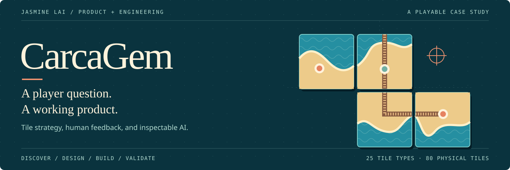
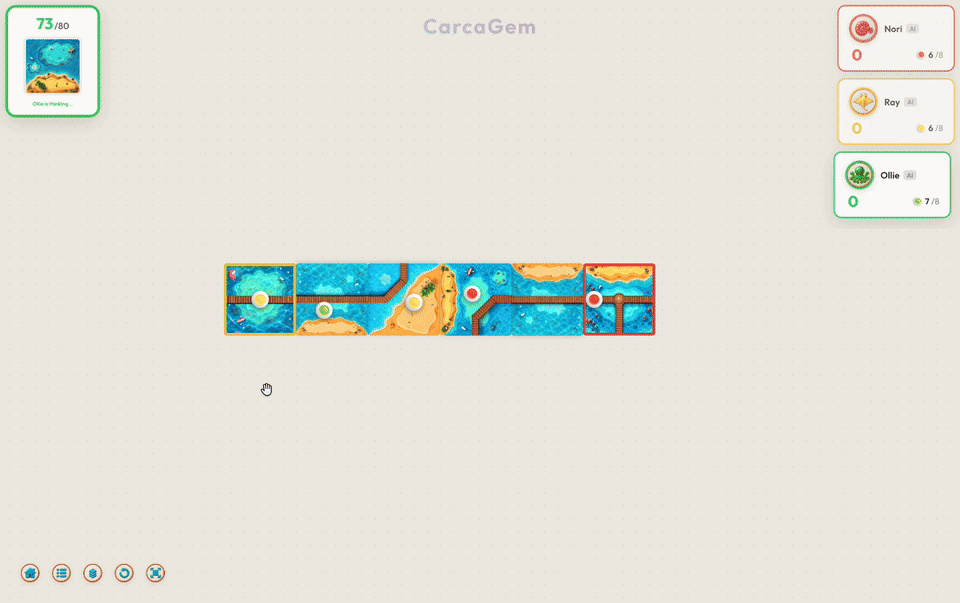
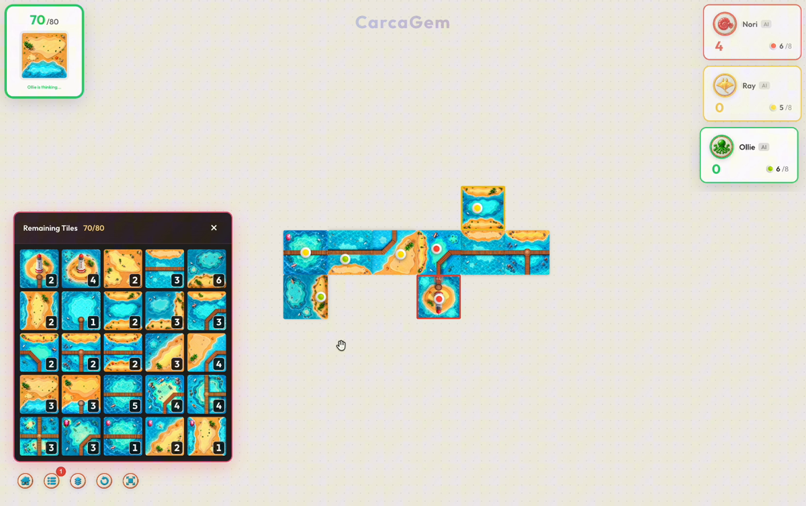

<h1 align="left"></h1>

<p align="center"><strong>语言 / Language</strong>　<strong><a href="README.zh-CN.md">🇨🇳 简体中文</a></strong>　·　<a href="README.md">🇺🇸 English</a></p>

<p align="center">
  <picture>
    <source media="(max-width: 600px)" srcset="docs/media/cover-mobile.svg">
    
  </picture>
</p>

**一款由真实玩家反馈推动、拥有可检查 AI 对手的网页策略桌游。**

CarcaGem 面向在手机或电脑上游玩的休闲策略玩家，将拼图放置、区域占领和计分呈现在同一张桌面上。你可以与 AI 对战、与朋友轮流共用一台设备，或在线创建房间一起玩。

项目由化学专业学生 **Jasmine Lai** 发起并主导，我使用 **Codex 作为 AI 编程工具**。我负责产品方向、界面设计、实现决策、部署和验证。[贡献与 AI 协作说明（英文）](docs/CONTRIBUTIONS.md)

<p align="center">
  <a href="https://carcagem.online/"><strong>开始游玩 ↗</strong></a> &nbsp; · &nbsp;
  <a href="#一次-ai-决策演示"><strong>运行示例</strong></a> &nbsp; · &nbsp;
  <a href="#三个值得阅读的代码入口"><strong>阅读代码</strong></a> &nbsp; · &nbsp;
  <a href="docs/PLAYER_GUIDE.zh-CN.md">中文新手指南</a>
</p>

<table>
  <tr>
    <td width="50%" align="center"><strong>20+</strong><br>外部试玩玩家</td>
    <td width="50%" align="center"><strong>100+</strong><br>与外部玩家进行的对局</td>
  </tr>
  <tr>
    <td align="center"><strong>10+</strong><br>产品迭代</td>
    <td align="center"><strong>65 项通过</strong><br>自动化测试</td>
  </tr>
</table>

试玩和迭代数量为我本人记录；自动化测试结果可以按下文步骤复现。

<p align="center">
  
</p>

*真实游戏画面：查看拼图、观察 AI 行动，并看到桌面和分数如何变化。下方还提供完整的电脑端和手机端录像。*

**3–5 分钟阅读路线：**先看一回合，再读三个代码入口，了解玩家反馈如何改变产品，最后复现验证结果。

## 一次 AI 决策演示

在[在线游戏](https://carcagem.online/)中选择 **Local Game（本地游戏）**，保留默认的人类和 AI 座位并开始游戏。点击高亮位置放置拼图，按 **R** 旋转，然后选择一个区域占领，或跳过本回合的占领操作。接下来轮到 AI 行动。

如果你想复现一组固定的「输入 → 决策 → 输出」，需要 Node.js 24 和仓库锁定的依赖版本：

```sh
npm ci && npm run demo
```

| 步骤 | 可查看的内容 |
| --- | --- |
| **输入** · [测试样例](examples/ai-turn.fixture.json) | 桌面已有 5 块拼图；抽到 20 号拼图；牌堆还剩 74 块；Nemo 还有 6 名探索者可用。 |
| **决策** · [可运行示例](examples/ai-turn.ts) | AI 从公开局面中评估 48 个合法候选行动，选择放置于坐标 `(0, 2)`、旋转 `0` 度并占领 `road-0`。 |
| **输出** · 已由断言验证 | 规则接受此行动；Nemo 获得 **2 分**；探索者返回；牌堆还剩 73 块，下一位行动玩家是 Ray。 |

这个演示为方便复现而固定了候选行动数量。正式游戏还会在时间限制内进行采样搜索。演示只用于讲解行动过程，不用于衡量 AI 的对战水平。

## 三个值得阅读的代码入口

| 入口 | 建议查看的内容 | 测试或示例 |
| --- | --- | --- |
| [游戏状态与计分](src/engine/game.ts) | 回合推进、区域完成、探索者返还，以及确保游戏结束计分只执行一次的逻辑。 | [规则与资源守恒测试](test_ai_upgrade.ts) |
| [AI 策略](src/engine/ai/strategy.ts) | 合法行动生成、拼图数量约束、经过校准的估值，以及有边界的对手应对搜索；AI 看不到牌堆的真实顺序。 | [公开信息与后备决策测试](test_ai_upgrade.ts)、[决策示例](examples/ai-turn.ts) |
| [多人游戏服务器](src/server.ts) | 服务器对行动的校验、当前回合玩家的判定、拒绝过期的 AI 结果，以及后台任务调度。 | [房间开始](test_network_start.ts)、[状态同步](test_online_bonus_sync.ts)、[工作线程失败处理](test_ai_pool.ts) |

游戏对手由符号规则、搜索和经验校准的估值共同组成；它在浏览器和服务器工作线程中运行，不依赖外部推理服务。[系统架构（英文）](docs/architecture.md)

## 玩家反馈如何改变了产品

玩家希望随时知道还剩多少拼图。我将这个请求理解为一项帮助玩家规划的需求：数量信息要能在**回合进行中**查看，已经耗尽的拼图类型也要保留显示，而且不能把手上已抽出的拼图重复算进牌堆。

我在本地和在线游戏中加入了一个包含 25 种拼图的数量面板。放置拼图或本地撤销之后，数量会更新；按 Escape 关闭面板时，键盘焦点会回到原来的控件。[面板实现](src/components/RemainingTilesPanel.tsx) · [四项回归测试](test_remaining_tiles.ts)

<details>
<summary>查看已实现的剩余拼图面板</summary>



</details>

玩家也希望 AI 更强。我改进了它的决策流程，并让本地和在线游戏使用同一套正式策略。关于 AI 对战人类玩家的观察仍属定性经验；目前没有声称完成了受控的人类胜率测试。

## 开发 CarcaGem 带给我的成长

> 一开始，我会把看起来不对的地方截图发给 Codex。即使问题被反复修复，我仍然没有信心，因为我还说不清问题是怎么产生的。转折点是我开始为区域和边缘命名，写下预期分数，并把这些状态展示出来。我发现，想要更有效地使用 AI，就要先把自己要它证明的事情说得更具体。

*内容摘译自我的开发笔记。* [五条工程实践体会（英文）](docs/DEVELOPMENT_NOTES.md)分别关联当前的数据模型、图遍历、测试和面向玩家的状态反馈。

## 如何核对项目证据

| 观点 | 证据和适用范围 |
| --- | --- |
| 游戏行为经过验证。 | **11 个测试文件中的 65 项测试**在本地通过；固定 AI 示例还会检查行动、计分和探索者返还。[验证报告（英文）](docs/VALIDATION.md) |
| 项目可以复现构建和检查。 | 前后端编译、测试、示例和资源审计可通过 `npm run verify` 和 [GitHub Actions](https://github.com/laizhiyin/carcagem/actions/workflows/verify.yml) 运行。 |
| 产品经过外部玩家试玩。 | 仓库提供在线版本和电脑端、手机端录像；试玩数量来自我的记录，不代表经独立核验的留存率或在线时长。 |
| 工程问题有据可查。 | 报告列出了 **41 项 ESLint 错误、1 项警告**，以及一个 3D 构建包体积警告；这些问题没有被算作通过项。 |

**工程取舍：**更强的搜索需要更多计算时间和工作线程。正式策略的搜索目标为 1.2 秒，服务器使用两个工作线程，并拒绝已经过期的结果。限定搜索预算有助于管理单次决策的开销，但它不是硬实时保证。

### 本地构建和运行

```sh
npm ci
npm run verify
HOST=127.0.0.1 npm start
```

打开 `http://localhost:3001`。验证流程会先构建后端，再运行套接字测试。原始游戏录像使用 Git LFS，可在运行示例和测试时省略；如需获取录像，可执行 `git lfs pull`。

[产品简报（英文）](docs/PRD.md) · [系统架构（英文）](docs/architecture.md) · [验证报告（英文）](docs/VALIDATION.md) · [开发笔记（英文）](docs/DEVELOPMENT_NOTES.md) · [贡献与许可说明（英文）](docs/CONTRIBUTIONS.md) · [部署说明（英文）](docs/DEPLOYMENT.md)

<details>
<summary>电脑端和手机端完整游戏录像</summary>

### 电脑端游戏录像

时长：2 分 12 秒。

https://github.com/user-attachments/assets/0bf076af-8bc7-4395-8277-dcf74e529e89

[下载 1080p 电脑端原始录像](https://media.githubusercontent.com/media/laizhiyin/carcagem/main/public/backgrounds/carcagem1080p.mp4)

### 手机端游戏录像

时长：2 分 2 秒。

https://github.com/user-attachments/assets/2358b9d6-03a5-411f-be28-6d72b951f8c7

[下载 1080p 手机端原始录像](https://media.githubusercontent.com/media/laizhiyin/carcagem/main/public/backgrounds/carcagem1080pmo.mp4)

</details>

**联系：**[Jasmine Lai](mailto:jasminelai@foxmail.com)
