# 图文新手指南

**语言 / Language：**[🇨🇳 简体中文](PLAYER_GUIDE.zh-CN.md) · [🇺🇸 English](PLAYER_GUIDE.md)

[中文项目介绍](../README.zh-CN.md) · [English project overview](../README.md) · [在线互动指南](https://carcagem.online/player-guide.html)

本指南介绍拼图放置、区域占领、计分方式和操作方法。

  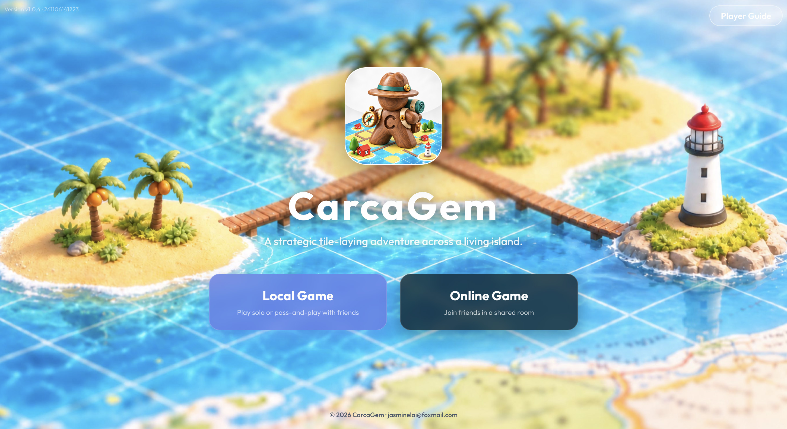

## 游戏概览

| 25 种拼图 | 每局 80 块拼图 | 2–3 名玩家 | 每位玩家 8 名探索者 |
| --- | --- | --- | --- |

80 块拼图中包含起始拼图。你可以与 AI 对战、与朋友轮流共用一台设备，或在不同设备上进入同一个在线房间。玩家可以选择昵称和颜色；每位玩家也会获得一个不同的海洋动物头像。

| Nemo | Shelly | Ray | Sunny |
| --- | --- | --- | --- |
| 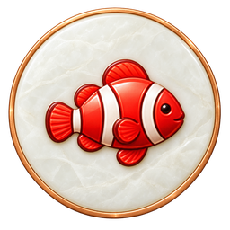 | 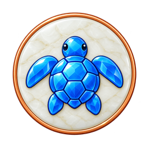 | 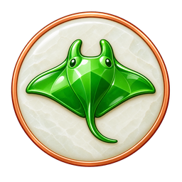 | 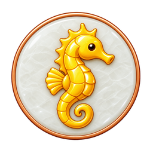 |

### 选择游戏方式

| 本地游戏 | 在线游戏 |
| --- | --- |
| 与 AI 对战，或由 2–3 名玩家轮流共用同一台设备。选择真人或 AI 座位，然后依次行动。 | 创建房间并分享邀请码，与使用各自设备的朋友一起游戏。房主负责开始游戏。 |

## 认识游戏桌面

左上角会显示当前待放置的拼图，右侧是玩家卡片，岛屿从中央逐渐展开。半透明格子表示合法的放置位置。拖动桌面可以平移，选中格子后可以旋转拼图或改选其他位置。

| 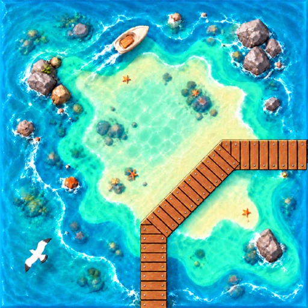 下一块拼图 |  玩家卡片 | 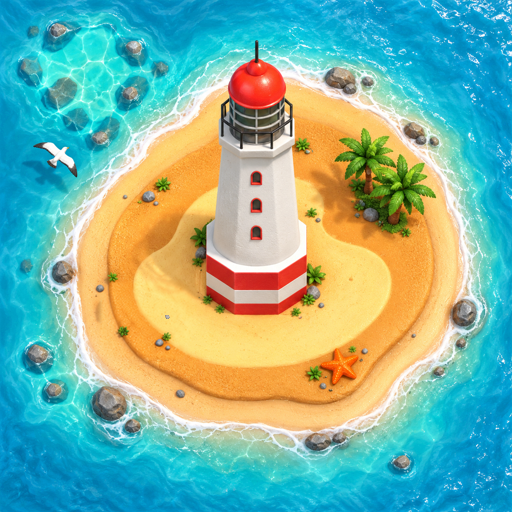 可占领的位置 |
| --- | --- | --- |
| 计数器显示牌堆中剩余拼图数量，满牌堆为 80 块。当前手中的拼图已经抽出，不计入剩余数量。 | 玩家卡片显示头像、昵称、分数和可用的探索者。当前行动的玩家会高亮显示。 | 彩色圆点表示可以派遣探索者的区域：蓝色为海洋、棕色为道路、黄色为海滩、红色为灯塔。 |

## 一个回合分三步

|  1. 放置拼图 |  2. 占领或跳过 | 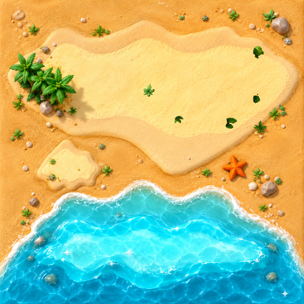 3. 计分并继续 |
| --- | --- | --- |
| 将抽到的拼图放在合法位置。每条相接的边都必须匹配：海洋接海洋、海滩接海滩、道路接道路。按 **R** 旋转拼图。 | 你可以选择是否将一名可用探索者放在新拼图上尚未被占领的区域。按 **空格键** 或选择“跳过”，将探索者留作后续使用。 | 道路、海滩或灯塔完成时会自动计分，对应区域中的探索者会返回。派往海洋的探索者会一直留在那里，直到游戏结束。 |

如果相连区域已经有探索者占领，即使是你自己的探索者，也不能再占领该区域。所有探索者都已派出时，你仍可以继续放置拼图；在有探索者返回之前，你不能再占领新的区域。

## 四种区域，各有不同计分方式

|  道路 / 木栈道 |  海滩 |
| --- | --- |
| 道路的每个开放端都与另一段道路相连时，即视为完成。完成时，或游戏结束时仍未完成，均按**每一块不同的拼图 1 分**计分。 | 海滩的所有外向边都相连且没有缺口时，即视为完成。完成时**每块拼图计 2 分**；游戏结束时仍未完成，则**每块拼图计 1 分**。 |

|  灯塔 | 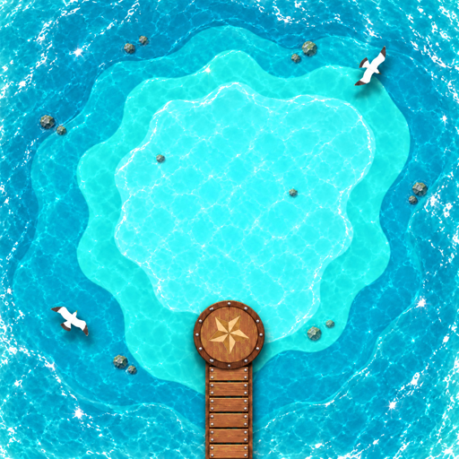 海洋 |
| --- | --- |
| 灯塔周围的 **8 个位置**（包括对角线位置）都放上拼图时，即视为完成，得 **9 分**；游戏结束时仍未完成，则每块周围拼图计 **1 分**。 | 海洋仅在游戏结束时计分：与该海洋相连的**每一片不同的已完成海滩计 3 分**，每片海滩只计算一次。未完成的海滩和灯塔不计入。 |

区域计分时，拥有最多探索者的玩家获得该区域全部分数。如果多位玩家的探索者数量并列最多，每位并列玩家都会获得完整分数，分数不会平分。留在海洋的探索者会一直占用到游戏结束，中途不会返回。

## 宝藏拼图与额外回合

红色宝石代表宝藏拼图。包含宝藏拼图的**道路或海滩**完成时，如果该区域至少有一名探索者，拥有最多探索者的玩家（或并列玩家）会获得一个额外回合。仅仅抽到或放置宝石拼图不会触发奖励。

| 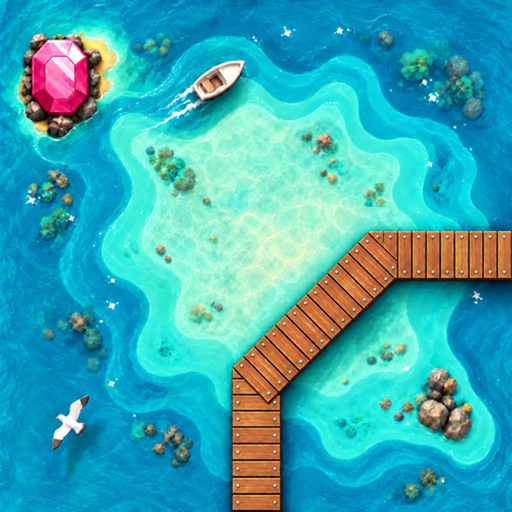 宝藏拼图 22 | 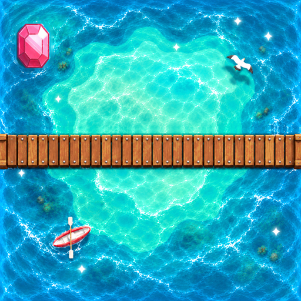 宝藏拼图 23 | 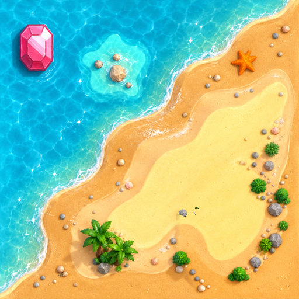 宝藏拼图 24 | 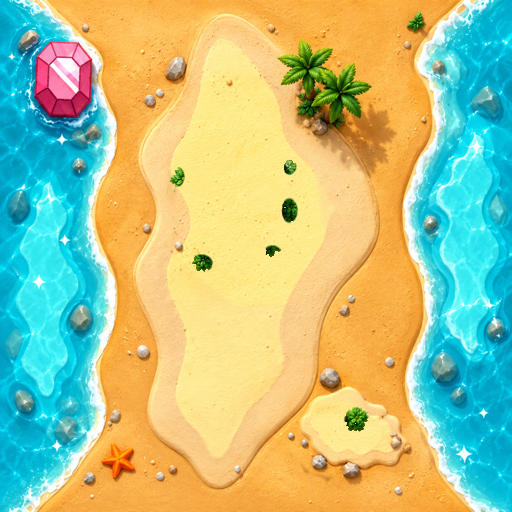 宝藏拼图 25 |
| --- | --- | --- | --- |

## 游戏结束与小技巧

最后一块拼图放置并计分后，或剩余拼图都无法合法放置时，游戏结束。未完成的道路、海滩和灯塔，以及已占领的海洋都会计分。已经计分的区域不会再次计分；将游戏结束时的分数加入当前总分即可。总分最高的玩家获胜。

- 情况允许时，**留 1–2 名探索者备用**。较短的道路和容易完成的海滩能更快得分、返还探索者，让你继续占领新区域。
- 在为高难度区域投入更多探索者之前，先查看**剩余拼图**。
- 占领海洋前先想清楚：探索者会留在海洋直到游戏结束，可以先估算它将接触多少片已完成海滩。
- 连接两个区域前，先数一数双方的探索者。连接可能改变多数归属，也可能让包含宝藏的区域完成。

## 剩余拼图与操作

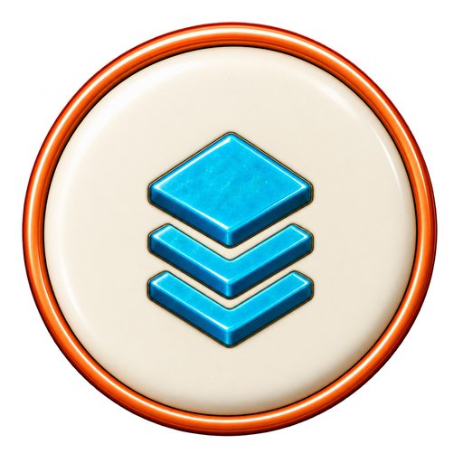 选择叠放拼图图标，即可在 5 × 5 网格中查看全部 25 种拼图。数量显示牌堆中尚未抽出的拼图，不包括手上的拼图或桌面上已经放置的拼图，且总数与牌堆计数器一致。起始拼图也包含在 80 块拼图中；新的一局抽出第一块拼图后，牌堆中还剩 78 块。

| 操作 | 作用 |
| --- | --- |
| **R** | 旋转当前拼图。 |
| **空格键** | 跳过派出探索者，并确认放置拼图。 |
| **Esc** | 关闭“剩余拼图”面板，或取消已选中的位置。 |
| **Ctrl / ⌘ + Z** | 在本地游戏中撤销回合。在线游戏不支持撤销。 |

在电脑上，拖动或滚动可以平移；按住 **Ctrl** 同时滚动可以缩放。在手机上，用一根手指拖动可平移，用两根手指捏合可缩放，同时移动两根手指也可以平移。点击拼图、位置或标记即可游玩。部分电脑浏览器支持全屏模式。

### 常见问题

- **当前拼图没有合法位置怎么办？** 游戏会检查其他拼图。如果剩余拼图都无法合法放置，游戏就会结束。
- **探索者都已经派出怎么办？** 继续放置拼图，并跳过派出探索者，直到有探索者返回。
- **在线游戏可以撤销吗？** 不可以。只有本地游戏支持撤销。
- **多人争夺区域时平分分数吗？** 不平分。并列最多的每位玩家都会获得该区域的完整分数和可能触发的宝藏额外回合。

## 开始游玩 CarcaGem

<a href="https://carcagem.online/"><strong>前往 carcagem.online 游玩最新线上版本 →</strong></a>

如果你想查看完整的互动指南，包括桌面操作演示、拼图旋转展示、实时计分示例、宝藏拼图图集和更多常见问题，请访问[线上玩家指南](https://carcagem.online/player-guide.html)。
