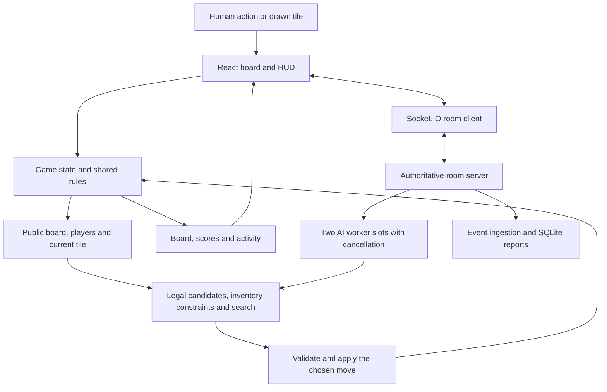

# Architecture and decision flow

CarcaGem has a React/TypeScript client, a shared rules engine, an AI policy and a Node.js service for Socket.IO rooms and first-party analytics.

## Input to decision to output

1. [Game.publicSnapshot](../src/engine/game.ts) clones board/player state, the current tile and scoring indexes. It excludes the real deck order and shuffle seed.
2. [The policy](../src/engine/ai/strategy.ts) enumerates legal placements and claims, derives remaining counts, and checks whether frontier cells compete for the same physical tiles.
3. Feature values combine scoring with [completion estimates](../src/engine/ai/completionModel.ts). Supported bins use bundled empirical data; other cases use a heuristic. An estimate is not a guarantee of closure.
4. Hard search samples hypothetical orders independently of the real deck, considers opponent replies and compares completed rounds.
5. The shared engine validates the chosen move. [The fixture](../examples/ai-turn.ts) exposes the resulting score and explorer return.

The deterministic example caps candidates at 48 and skips sampled rollouts. Production uses a best-effort 1,200 ms budget; a loop-boundary check cannot interrupt an expensive operation already in progress.

## Responsiveness and consistency

[Browser workers](../src/engine/ai.ts) move search off the UI thread and provide failure fallbacks. [Pacing](../src/engine/ai/pacing.ts) keeps an AI turn visible for at least 1,200 ms; this display delay is separate from computation.

[The server](../src/server.ts) checks membership, ownership and action validity. Revision checks reject stale AI results. [The pool](../src/botPool.ts) permits two active jobs, caps the queue at 64 and supports cancellation/timeouts.

Rooms are process-local. Durable recovery and horizontal coordination remain open work.

## Data and deployment

Local play can run in the browser. Online rooms need Node.js. Browser and server events feed SQLite analytics; the existence of analytics code is not evidence for a particular player count.

OpenResty/Nginx terminates HTTPS and serves static files, forwarding API/Socket.IO traffic to Node.js. Persistent analytics data belongs outside the public document root. [Deployment](DEPLOYMENT.md) contains configuration patterns without credentials.
